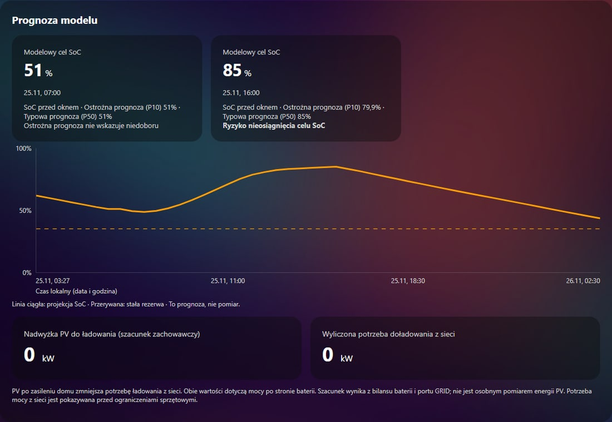
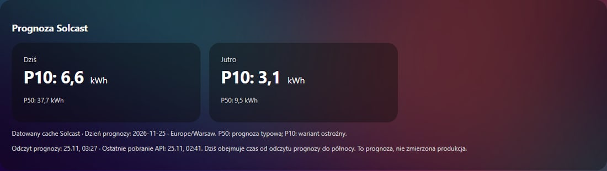
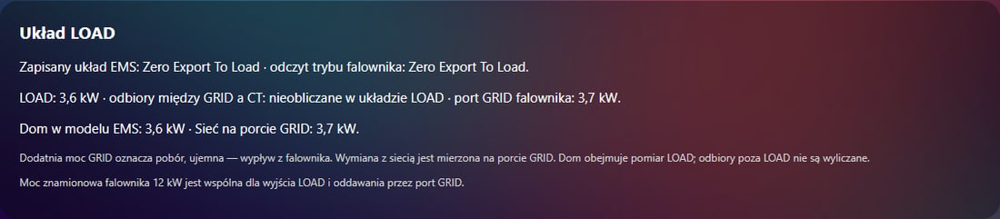
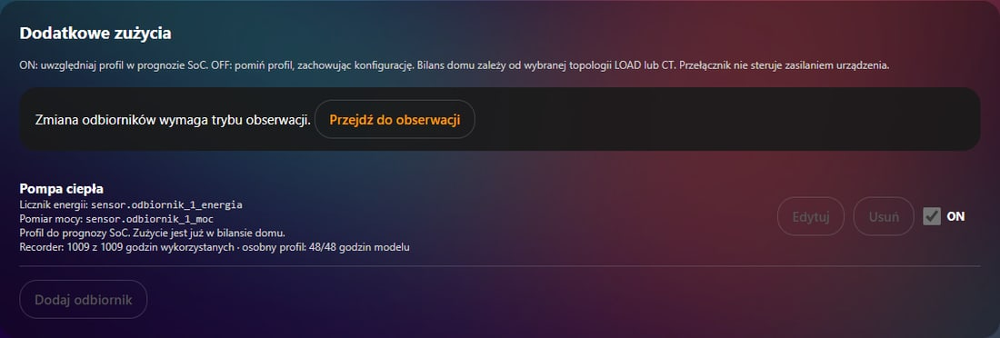
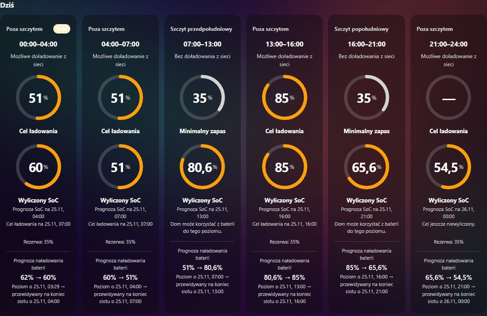
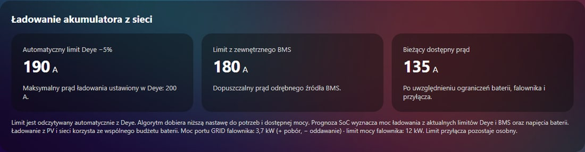

# Deye EMS

[Polski](#polski) · [English](#english) · [Wydania / Releases](https://github.com/gaszu/deye-ems/releases)

**Aktualne wydanie / Current release:** [Deye EMS 2.6.7](https://github.com/gaszu/deye-ems/releases/tag/v2.6.7)

## Polski

**Deye EMS jest przeznaczony dla „starych” prosumentów rozliczanych w systemie opustów (net-metering).**

**Deye EMS to lokalny system zarządzania energią dla Home Assistant, przeznaczony do instalacji z hybrydowym falownikiem Deye i magazynem energii.** Wyznacza cele naładowania baterii (SoC) na podstawie prognozy produkcji PV, przewidywanego zużycia domu, taryfy i zadanej rezerwy. Następnie dopasowuje ładowanie z sieci do bieżących warunków. Silnik działa w Home Assistant. Solcast jest opcjonalnym źródłem prognozy PV.

### Jak działa

1. **Planowanie.** EMS łączy prognozę PV, profil zużycia z historii Home Assistant i kalendarz taryfy. Panel pokazuje prognozę SoC, cele ładowania i plan na dziś oraz jutro.
2. **Sterowanie.** W slotach dopuszczających ładowanie EMS zarządza ustawieniem Grid Charge i reguluje prąd. Bierze pod uwagę aktualne pomiary, dostępną moc, limity falownika i przyłącza oraz ograniczenia BMS. W dozwolonym oknie nocnym priorytetem jest osiągnięcie porannego celu SoC. Po osiągnięciu celu histereza zapobiega częstemu wznawianiu ładowania.
3. **Zabezpieczenia.** Ustawienia rezerwy, stan baterii, aktualność pomiarów i zgodność odczytów z konfiguracją ograniczają działanie regulatora. Tryb obserwacji pokazuje plan i diagnostykę bez przejmowania sterowania falownikiem.
4. **TOP BALANCE.** Operator może zadać własny cel SoC do 100%, w zakresie akceptowanym przez falownik, i uruchomić ładowanie z sieci także w drogiej strefie. EMS respektuje limity instalacji i BMS. Po osiągnięciu celu lub ręcznym zakończeniu przywraca nastawy slotu i wraca do zwykłego planu. Balansowaniem ogniw zajmuje się BMS.

*Zrzuty panelu Deye EMS 2.4.1 w motywie iOS Dark Blue-Red z rzeczywistymi pomiarami z jednej instalacji. Nazwy encji zostały ukryte.*

### Zintegrowany Solcast

Deye EMS ma własnego klienta Solcast API, dostępnego z panelu Home Assistant. Można skonfigurować jedną lub kilka instalacji PV, ustalić odstęp pobierania i dopasować budżet zapytań do konta. Panel pokazuje prognozy P50 i P10 na dziś, pozostałą część dnia i jutro oraz wskazuje, czy dane pochodzą z API, lokalnego cache czy encji Home Assistant. EMS sprawdza aktualność i pokrycie prognozy przed użyciem jej do planowania. Można też korzystać z prognozy udostępnianej przez istniejące encje Home Assistant. [Konfiguracja Solcast](INSTALL.md#solcast--konfiguracja-w-panelu)

#### Co oznaczają P10 i P50

- **P10** to dolny, 10. percentyl prognozy PV, czyli scenariusz ze słabszą produkcją. Silnik używa go do wyliczenia zapasu energii potrzebnego przed okresem bez planowego ładowania z sieci. Sprawdza na nim także, czy bateria dojdzie do celu na czas i czy latem grozi niedobór uzasadniający awaryjne doładowanie.
- **P50** to mediana prognozy PV, czyli scenariusz środkowy. Silnik używa go do rysowania prognozy SoC w panelu i do oceny, jaką część oczekiwanego zużycia pokryje PV przy wyznaczaniu zimowego celu pogodowego.

Dokładna nastawa prądu uwzględnia bieżące pomiary i limity. Percentyle są danymi wejściowymi scenariuszy planowania. Nie określają prawdopodobieństwa osiągnięcia celu SoC dla całej doby. [Parametry Solcast](https://docs.solcast.com.au/docs/output-parameters) · [Implementacja planera](custom_components/deye_ems/planner.py)

Pod każdym celem w prognozie modelu panel pokazuje SoC w P10 i P50 oraz ryzyko niedoboru. Nagłówek pokazuje cel faktycznie używany przez regulator.

### Falowniki i układy pomiarowe

Katalog zawiera profile wybranych europejskich, niskonapięciowych falowników hybrydowych Deye. Przy konfiguracji wybierz dokładny model z listy.

| Rodzina | Fazy | Zakres mocy modeli w katalogu |
| --- | --- | --- |
| SUN-SG04LP1-EU | 1 | 3–6 kW |
| SUN-SG05LP1-EU-SM2-P | 1 | 3,6–10 kW |
| SUN-SG04LP3-EU | 3 | 5–12 kW |
| SUN-SG05LP3-EU-SM2 | 3 | 3–20 kW |

Konfiguracja własna pozwala ręcznie określić parametry falownika i przypisać wymagane encje. Integracja obsługuje **Zero Export To Load**, gdzie dom jest mierzony na wyjściu LOAD, oraz **Zero Export To CT**, gdzie osobne odczyty portu GRID i licznika CT pozwalają uwzględnić również odbiorniki między falownikiem a przyłączem. Możliwość sterowania zależy od dostępności wymaganych pomiarów i nastaw TOU w Home Assistant. [Katalog modeli](custom_components/deye_ems/inverter_models.py)

### Własne odbiorniki

W panelu wybierz **Dodaj odbiornik**. Podaj nazwę, wybierz licznik energii w Wh lub kWh i opcjonalnie encję chwilowej mocy w W lub kW. Możesz w ten sposób osobno modelować np. pompę ciepła, grzałkę CWU lub ładowarkę samochodu. Konfigurację zmieniasz w trybie obserwacji. Przełącznik ON/OFF włącza lub wyłącza osobne modelowanie kanału z zachowaniem konfiguracji. Nie przełącza fizycznego urządzenia.

- **Zero Export To Load** — podstawą jest zużycie mierzone na wyjściu LOAD. Dodawaj kanały odbiorników ujętych w tym pomiarze. Odbiornik po stronie GRID nie wchodzi do tej prognozy przez samo dodanie jego licznika.
- **Zero Export To CT** — model uwzględnia LOAD oraz odbiory między portem GRID falownika a licznikiem CT, wyznaczone z bilansu pomiarów. Kanał może dotyczyć odbiornika po dowolnej z tych stron, o ile jego zużycie jest już częścią tego bilansu.

Przy kolejnych przeliczeniach planu EMS pobiera z historii Home Assistant nowe dostępne statystyki godzinowe i aktualizuje profil zużycia. Sięga do 42 dni wstecz. Porównuje ostatni tydzień z wcześniejszymi tygodniami dla danej godziny i, gdy danych jest wystarczająco dużo, osobno dla dni roboczych i weekendów. Ograniczona korekta trendu stopniowo uwzględnia trwały wzrost lub spadek poboru. Regulator może natychmiast ograniczyć ładowanie po skoku poboru, a prąd przywraca zgodnie z odstępami i progami sterowania. Odbiornik bez użytecznej historii pozostaje w profilu łącznym i nie blokuje innych liczników. Zmiana prognozy może wpłynąć na przewidywany SoC, potrzebny zapas i cele ładowania.

Żeby uniknąć podwójnego doliczania energii, EMS odejmuje historyczne zużycie osobno modelowanego odbiornika od pomiaru łącznego, a następnie sumuje prognozę odbiornika z prognozą pozostałego zużycia. Ograniczanie importu nadal korzysta z bieżących pomiarów instalacji. [Konfiguracja odbiorników](INSTALL.md#dodatkowe-zużycia)

### Taryfy

Do nowej konfiguracji można wybrać **TAURON Dystrybucja G11, G12, G12w i G13**. Kalendarz stosuje reguły danego profilu, w tym sezonowość, dni tygodnia i święta tam, gdzie przewiduje je taryfa. Przy zapisie trzeba potwierdzić zgodność profilu z umową oraz wybrać sposób pracy zegara licznika. Katalog zawiera też profile informacyjne innych operatorów i zachowuje wcześniej zapisane profile zgodnie z ich regułami. Zakres dostępny dla nowej konfiguracji określa selektor taryf. [Katalog taryf](custom_components/deye_ems/tariff_profiles.json) · [Reguły wyboru](custom_components/deye_ems/tariff_settings.py)

### Bateria, BMS i YamBMS

- **Deye** jest domyślnym źródłem danych. EMS odczytuje z encji falownika SoC, napięcie, bieżący limit prądu ładowania oraz alarmy i błędy baterii dostępne z komunikacji falownika z BMS.
- **YamBMS** jest opcjonalnym źródłem danych magazynu. Może udostępniać zagregowany SoC, napięcie, limit prądu i blokadę ładowania z jednego lub kilku BMS. EMS odczytuje te dane z encji Home Assistant, a polecenia ładowania nadal przekazuje falownikowi Deye.
- **Ręczne przypisanie** pozwala wskazać encje z własnej integracji BMS. Przy sprzęcie takim jak JK-BMS zgodność zależy od tego, czy Deye, YamBMS lub osobna integracja poprawnie udostępnia wymagane pomiary oraz sygnały blokady lub alarmu.

### Instalacja i dokumentacja

Instalacja wymaga fizycznego mostka **Modbus RS‑485** podłączonego do portu RS‑485 falownika. Mostek przekazuje dane do Home Assistant przez Wi‑Fi lub przewodowy LAN. Deye EMS korzysta z encji udostępnionych przez integrację obsługującą mostek. Do aktywnego sterowania te encje muszą również umożliwiać zapis nastaw ładowania.

Zainstaluj integrację przez Marketplace albo użyj paczki ZIP z opublikowanego wydania. Po dodaniu integracji panel Deye EMS jest dostępny w menu bocznym administratora.

[Instrukcja instalacji](INSTALL.md) · [Specyfikacja silnika](SPECIFICATION.md) · [Podgląd na danych syntetycznych](preview/README.md) · [Wydania](https://github.com/gaszu/deye-ems/releases)

## English

**Deye EMS is designed for Polish prosumers on the legacy net metering scheme (system opustów).**

**Deye EMS is a local energy management system for Home Assistant installations with a Deye hybrid inverter and battery storage.** It sets battery state-of-charge (SoC) targets using the PV forecast, expected household demand, the electricity tariff and a configured reserve. It then adjusts grid charging to measured conditions. The engine runs in Home Assistant. Solcast is an optional source of PV forecasts.

### How it works

1. **Planning.** The engine combines the PV forecast, a demand profile derived from Home Assistant history and the tariff calendar. The dashboard shows the projected SoC, charge targets and the plan for today and tomorrow.
2. **Control.** In slots that allow grid charging, EMS manages the inverter’s Grid Charge setting and adjusts the charge current. It uses live measurements, available power, inverter and service connection limits, and BMS constraints. During an eligible overnight window, it prioritises the morning SoC target. After reaching the target, hysteresis avoids frequent restarts.
3. **Safeguards.** The battery reserve, battery status, measurement freshness and consistency with the configured installation all constrain control. Observation mode shows the plan and diagnostics without taking control of the inverter.
4. **TOP BALANCE.** An operator can set an SoC target up to 100%, within the inverter’s accepted range, and start grid charging even during an expensive tariff period. EMS respects installation and BMS limits. When the target is reached or the operator stops the session, EMS restores the slot settings and resumes the normal plan. The BMS handles cell balancing.

*Deye EMS 2.4.1 screenshots using the iOS Dark Blue-Red theme and real measurements from one installation. Entity IDs are masked.*

### Built-in Solcast

Deye EMS includes a Solcast API client configured from its Home Assistant panel. You can configure one or more PV sites, set the polling interval and match the request budget to your account. The panel shows P50 and P10 forecasts for today, the rest of today and tomorrow, and identifies whether the data came from the API, the local cache or Home Assistant entities. EMS checks forecast freshness and coverage before using it to plan charging. Forecasts exposed by existing Home Assistant entities are also supported. [Solcast setup](INSTALL.md#solcast--konfiguracja-w-panelu)

#### What P10 and P50 mean

- **P10** is the lower, 10th percentile of the PV forecast, a scenario with weaker production. The engine uses it to size the energy buffer for periods without scheduled grid charging, check whether the battery can reach its target on time, and detect summer shortfalls that may warrant an emergency top-up.
- **P50** is the median PV forecast, the central scenario. The engine uses it for the projected SoC chart and to estimate how much expected demand PV can cover when setting the winter weather-based target.

Live measurements and limits inform the actual charge current. The percentiles are inputs to planning scenarios. They do not give a probability of reaching an SoC target over an entire day. [Solcast output parameters](https://docs.solcast.com.au/docs/output-parameters) · [Planner implementation](custom_components/deye_ems/planner.py)

Each target in the model forecast shows P10 and P50 SoC and any shortage risk. The dashboard header shows the target actually used by the controller.

### Inverters and metering layouts

The catalogue includes profiles for selected European low-voltage Deye hybrid inverters. Choose the exact model during setup.

| Family | Phases | Power range of listed models |
| --- | --- | --- |
| SUN-SG04LP1-EU | 1 | 3–6 kW |
| SUN-SG05LP1-EU-SM2-P | 1 | 3.6–10 kW |
| SUN-SG04LP3-EU | 3 | 5–12 kW |
| SUN-SG05LP3-EU-SM2 | 3 | 3–20 kW |

A custom profile allows manual entry of inverter parameters and mapping of the required entities. The integration supports **Zero Export To Load**, where household demand is measured at the LOAD output, and **Zero Export To CT**, where separate GRID-port and CT readings also account for loads between the inverter and the service connection. Control requires the relevant measurements and writable Time of Use (TOU) settings in Home Assistant. [Inverter catalogue](custom_components/deye_ems/inverter_models.py)

### Custom loads

In the panel, select **Add load**. Enter a name, choose an energy meter in Wh or kWh, and optionally select a live power entity in W or kW. This lets you model devices such as a heat pump, water heater or EV charger separately. Edit the configuration in observation mode. The ON/OFF switch enables or disables separate modelling for the channel and preserves its configuration. It does not switch the physical device.

- **Zero Export To Load** — the forecast starts from demand measured at the LOAD output. Add channels for devices already included in that measurement. Adding a GRID-side meter alone does not bring that load into the forecast.
- **Zero Export To CT** — the forecast includes LOAD and demand between the inverter’s GRID port and the CT meter, calculated from the meter balance. A channel can represent a device on either side, provided its demand is already part of that balance.

When recalculating the plan, EMS reads the latest available hourly statistics from Home Assistant and updates the demand profile. It looks back up to 42 days and compares the latest week with earlier weeks for the same hour, separately for weekdays and weekends where enough data is available. A bounded trend adjustment gradually accounts for persistent changes. The controller can reduce charge current immediately in response to a demand spike and restores it according to the dispatch intervals and thresholds. A device with insufficient history stays in the aggregate demand profile and does not block other meters. The updated forecast can affect projected SoC, the required energy buffer and charge targets.

To avoid double-counting, EMS subtracts each separately modelled device’s historical demand from the aggregate measurement, then adds the device forecast to the forecast for the remaining demand. Import limiting continues to use live installation measurements. [Load setup](INSTALL.md#dodatkowe-zużycia)

### Tariffs

New configurations can select **TAURON Dystrybucja G11, G12, G12w and G13**. The calendar applies each profile’s rules, including seasons, weekdays and public holidays where relevant. Setup asks the operator to confirm that the tariff matches their contract and to select the meter’s clock basis. The catalogue also contains reference profiles for other operators. Existing saved profiles are retained according to their own rules. The tariff selector determines which profiles are available for new configurations. [Tariff catalogue](custom_components/deye_ems/tariff_profiles.json) · [Selection rules](custom_components/deye_ems/tariff_settings.py)

### Battery, BMS and YamBMS

- **Deye** is the default battery data source. EMS reads the SoC, voltage, current charge limit, alarms and faults that the inverter exposes from its BMS link.
- **YamBMS** is an optional battery data source. It can expose aggregate SoC, voltage, charge current limit and charge blocking from one or more BMS units. EMS reads those Home Assistant entities and continues to send charge commands to the Deye inverter.
- **Manual mapping** allows entities from a separate BMS integration. With hardware such as JK-BMS, compatibility depends on whether Deye, YamBMS or another integration exposes the required measurements and charge-blocking or alarm signals correctly.

### Installation and documentation

The installation requires a physical **Modbus RS‑485** bridge connected to the inverter’s RS‑485 port. The bridge delivers data to Home Assistant over Wi‑Fi or wired LAN. Deye EMS uses the entities exposed by the integration that handles the bridge. For active control, those entities must also allow writing charge settings.

Install through Marketplace or use the ZIP from a published release. Once the integration has been added, the Deye EMS panel appears in the administrator’s sidebar.

[Installation guide](INSTALL.md) · [Engine specification](SPECIFICATION.md) · [Demo with synthetic data](preview/README.md) · [Releases](https://github.com/gaszu/deye-ems/releases)

## Pliki projektu / Repository layout

W obu trybach wewnętrzne CT Deye mierzy port GRID. W Zero Export To CT zewnętrzne CT mierzy przyłącze. In both modes, Deye internal CT measures the GRID port. External CT measures the utility connection in Zero Export To CT.

Deye EMS można również osadzić w natywnym pulpicie Home Assistant. Deye EMS can also be embedded in a native Home Assistant dashboard. [Instalacja / Setup](INSTALL.md#deye-ems-w-natywnym-pulpicie-home-assistant)

Poniższy przewodnik opisuje wydanie **2.6.7**. The layout below describes release **2.6.7**.

| Ścieżka / Path | Zawartość / Contents |
| --- | --- |
| [custom_components/deye_ems](custom_components/deye_ems) | Kod integracji / Integration source · **2.6.7** |
| [tests](tests) | Testy offline / Offline tests · **2.6.7** |
| [preview](preview) | Aktualny panel z danymi syntetycznymi / Current panel with synthetic data · **2.6.7** |
| [release-notes](release-notes) | Notatki bieżącego wydania / Current release notes · **2.6.7** |

Paczki ZIP i archiwum wersji są w [GitHub Releases](https://github.com/gaszu/deye-ems/releases). Published ZIPs and release history are available in [GitHub Releases](https://github.com/gaszu/deye-ems/releases).
